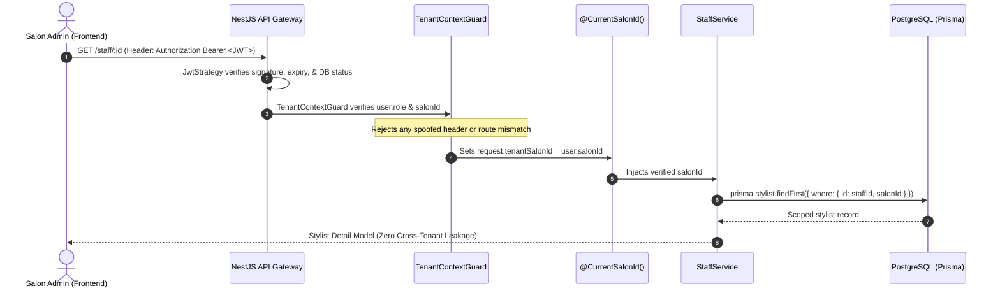

# StyleSlot Stylist Module Architecture Blueprint
## High-Performance Aggregated Detail Model & In-Place State Mutation

- **Document Version**: `2.0.0-ENTERPRISE`
- **Target Subsystem**: Stylist / Staff Management Hub
- **Author**: StyleSlot Core Engineering
- **Date**: 2026-10-12
- **Status**: Approved Architectural Standard

---

## 1. Executive Summary & Problem Statement

### 1.1 The Legacy Bottleneck
In legacy implementations, admin dashboard operations suffered from two primary performance bottlenecks:
1. **Over-fetching on List Views**: The initial staff list endpoint (`GET /staff`) loaded heavy relation graphs (all working hours, all assigned services, all absence records) for every stylist across the entire salon, resulting in large payload sizes and slow database execution.
2. **Brute-Force Cache Busting on Mutations**: Whenever an admin marked a leave, updated a shift, or assigned a service, the mutation endpoint returned a minimal `{ success: true }`. This forced the frontend to call `loadData(true)` to re-fetch the entire salon staff array, triggering full screen re-renders, flashing loading spinners, and state desynchronization.

### 1.2 The New Solution
This blueprint introduces the **Aggregated Detail Model with In-Place State Patching**:
1. **Lightweight List API (`GET /staff`)**: Returns only summary cards required for sidebar navigation.
2. **Composite Detail Aggregate (`GET /staff/:id`)**: Loaded on-demand when a stylist is selected. Composed of discrete, typed sub-models.
3. **Self-Healing Mutation Responses**: Every `POST`, `PUT`, `PATCH`, and `DELETE` endpoint returns the newly mutated sub-model and updated `operationalStatus`. The frontend immediately patches its in-memory state object without issuing any subsequent `GET` requests.

---

## 2. Multi-Tenant Security & Isolation Architecture

Multi-tenant isolation is enforced at the server level via cryptographic JWT claims.



### Security Rules:
- **Never accept `salonId` in client query parameters or request bodies** for admin operations.
- The backend derives `salonId` strictly from `request.user.salonId`.
- Any conflicting client headers (`x-salon-id`) from non-superadmin accounts trigger an immediate `403 Forbidden` (`Cross-tenant access attempt rejected`).

---

## 3. Core Data Models & Schemas

### 3.1 Sub-Models

#### 3.1.1 `StylistSummaryModel` (List Card)
```typescript
export interface StylistSummaryModel {
  id: string;
  name: string;
  phone: string | null;
  email: string | null;
  profileImageUrl: string | null;
  status: 'ACTIVE' | 'INACTIVE';
  operationalStatus: 'AVAILABLE' | 'BUSY' | 'ON_BREAK' | 'ON_LEAVE' | 'OFF_DUTY';
  followsSalonSchedule: boolean;
  assignedServicesCount: number;
}
```

#### 3.1.2 `StylistProfileModel` (Core Profile)
```typescript
export interface StylistProfileModel {
  id: string;
  salonId: string;
  name: string;
  phone: string | null;
  email: string | null;
  profileImageUrl: string | null;
  status: 'ACTIVE' | 'INACTIVE';
  operationalStatus: 'AVAILABLE' | 'BUSY' | 'ON_BREAK' | 'ON_LEAVE' | 'OFF_DUTY';
  followsSalonSchedule: boolean;
  createdAt: string; // ISO 8601
  updatedAt: string; // ISO 8601
}
```

#### 3.1.3 `BreakItemModel` & `WorkingHourItemModel` (Schedule)
```typescript
export interface BreakItemModel {
  id: string;
  dayOfWeek: 'MONDAY' | 'TUESDAY' | 'WEDNESDAY' | 'THURSDAY' | 'FRIDAY' | 'SATURDAY' | 'SUNDAY';
  startTime: string; // "HH:mm" (e.g., "13:00")
  endTime: string;   // "HH:mm" (e.g., "14:00")
  title: string;     // e.g. "Lunch Break"
  origin: 'SALON' | 'STYLIST';
  isLocked: boolean; // true if inherited from Salon Working Hours
}

export interface WorkingHourItemModel {
  id?: string;
  dayOfWeek: 'MONDAY' | 'TUESDAY' | 'WEDNESDAY' | 'THURSDAY' | 'FRIDAY' | 'SATURDAY' | 'SUNDAY';
  isWorking: boolean;
  startTime: string; // "09:00"
  endTime: string;   // "18:00"
  hasBreakOverride: boolean;
  breaks: BreakItemModel[];
}
```

#### 3.1.4 `StylistServiceModel` (Service Catalog)
```typescript
export interface StylistServiceModel {
  serviceId: string;
  name: string;
  categoryId: string;
  categoryName: string;
  durationMinutes: number;
  price: number;
  status: 'ACTIVE' | 'INACTIVE';
  assignedAt: string;
}
```

#### 3.1.5 `StylistLeaveModel` (Absence Record)
```typescript
export interface StylistLeaveModel {
  id: string;
  stylistId: string;
  startDate: string; // "YYYY-MM-DD"
  endDate: string;   // "YYYY-MM-DD"
  leaveType: 'SICK_LEAVE' | 'CASUAL_LEAVE' | 'PLANNED_LEAVE' | 'UNPLANNED_ABSENCE';
  leavePortion: 'FULL_DAY' | 'FIRST_HALF' | 'SECOND_HALF' | 'CUSTOM_INTERVAL';
  customStartTime?: string | null;
  customEndTime?: string | null;
  reason: string;
  notes?: string | null;
  status: 'ACTIVE' | 'CANCELLED';
  statusKey: 'ON_LEAVE' | 'CANCELLED';
  statusTitle: string; // "🟢 On Leave" | "❌ Cancelled"
  isPast: boolean;
  canCancel: boolean;
  affectedBookingsCount: number;
  reassignedCount: number;
  unresolvableCount: number;
  createdAt: string;
}
```

#### 3.1.6 `StylistStatsModel` (KPI Metrics)
```typescript
export interface StylistStatsModel {
  todayAppointmentsCount: number;
  todayCompletedCount: number;
  monthlyRevenue: number;
  averageRating: number;
  totalReviewsCount: number;
}
```

---

### 3.2 The Root Aggregate Model: `StylistDetailModel`
Returned by `GET /staff/:id`:
```typescript
export interface StylistDetailModel {
  profile: StylistProfileModel;
  workingHours: WorkingHourItemModel[];
  breaks: BreakItemModel[];
  services: StylistServiceModel[];
  leaves: StylistLeaveModel[];
  stats: StylistStatsModel;
}
```

---

## 4. Complete API Catalog & Operational Specifications

### 4.1 Query (Read) APIs

```
┌────────────────────────────────────────────────────────────────────────┐
│ 1. GET /api/v1/staff                                                   │
├────────────────────────────────────────────────────────────────────────┤
│ Purpose: Sidebar navigation & high-level summary roster                │
│ Headers: Authorization: Bearer <token>                                 │
│ Query:   targetDate?: string (YYYY-MM-DD)                              │
│ Res:     200 OK -> Array<StylistSummaryModel>                          │
└────────────────────────────────────────────────────────────────────────┘
```
**Sample Response Payload**:
```json
[
  {
    "id": "st-101",
    "name": "Sarah Connor",
    "phone": "+91 98765 43210",
    "email": "sarah@salon.com",
    "profileImageUrl": "https://cdn.styleslot.com/avatars/sarah.jpg",
    "status": "ACTIVE",
    "operationalStatus": "AVAILABLE",
    "followsSalonSchedule": false,
    "assignedServicesCount": 8
  }
]
```

```
┌────────────────────────────────────────────────────────────────────────┐
│ 2. GET /api/v1/staff/:id                                               │
├────────────────────────────────────────────────────────────────────────┤
│ Purpose: On-demand composite aggregate for active stylist hub          │
│ Headers: Authorization: Bearer <token>                                 │
│ Params:  id (UUID of stylist)                                          │
│ Res:     200 OK -> StylistDetailModel                                  │
└────────────────────────────────────────────────────────────────────────┘
```

---

### 4.2 Mutation (Write) APIs & In-Place State Contracts

#### 4.2.1 Leave Management

##### `POST /api/v1/staff/:id/leaves`
- **Purpose**: Creates an absence record, resolves appointment conflicts, and derives operational duty.
- **Request Body**:
```json
{
  "startDate": "2026-10-14",
  "endDate": "2026-10-15",
  "leaveType": "CASUAL_LEAVE",
  "leavePortion": "FULL_DAY",
  "reason": "Family function",
  "notes": "Emergency phone active",
  "reassignmentStrategy": "AUTO_REASSIGN"
}
```
- **Response `201 Created`**:
```json
{
  "newLeave": {
    "id": "leave-201",
    "stylistId": "st-101",
    "startDate": "2026-10-14",
    "endDate": "2026-10-15",
    "leaveType": "CASUAL_LEAVE",
    "leavePortion": "FULL_DAY",
    "reason": "Family function",
    "status": "ACTIVE",
    "statusKey": "ON_LEAVE",
    "statusTitle": "🟢 On Leave",
    "isPast": false,
    "canCancel": true,
    "affectedBookingsCount": 3,
    "reassignedCount": 3,
    "unresolvableCount": 0,
    "createdAt": "2026-10-12T10:50:00.000Z"
  },
  "operationalStatus": "ON_LEAVE",
  "reassignmentSummary": {
    "total": 3,
    "reassigned": 3,
    "unresolvable": 0
  }
}
```
- **Frontend Mutation Logic**:
```javascript
// Prepend new leave to active detail state
state.activeStaffDetail.leaves.unshift(res.newLeave);

// Sync operational status if leave covers today
if (isDateToday(res.newLeave.startDate)) {
  state.activeStaffDetail.profile.operationalStatus = res.operationalStatus;
  const sidebarItem = state.staffList.find(s => s.id === staffId);
  if (sidebarItem) sidebarItem.operationalStatus = res.operationalStatus;
}

// Re-render only target components
StaffLeavesView.renderTable(state.activeStaffDetail.leaves);
StaffProfileHub.renderStatusCards(state.activeStaffDetail);
```

##### `DELETE /api/v1/staff/:id/leaves/:leaveId`
- **Purpose**: Cancels a future or active leave.
- **Response `200 OK`**:
```json
{
  "cancelledLeaveId": "leave-201",
  "updatedLeave": {
    "id": "leave-201",
    "status": "CANCELLED",
    "statusKey": "CANCELLED",
    "statusTitle": "❌ Cancelled",
    "canCancel": false
  },
  "operationalStatus": "AVAILABLE"
}
```
- **Frontend Mutation Logic**:
```javascript
const target = state.activeStaffDetail.leaves.find(l => l.id === leaveId);
if (target) Object.assign(target, res.updatedLeave);
state.activeStaffDetail.profile.operationalStatus = res.operationalStatus;

StaffLeavesView.renderTable(state.activeStaffDetail.leaves);
StaffProfileHub.renderStatusCards(state.activeStaffDetail);
```

---

#### 4.2.2 Working Hours & Shift Roster

##### `PUT /api/v1/staff/:id/working-hours`
- **Purpose**: Configures weekly shift schedule with validation against future booked appointments.
- **Request Body**:
```json
{
  "followsSalonSchedule": false,
  "hours": [
    {
      "dayOfWeek": "MONDAY",
      "isWorking": true,
      "startTime": "09:00",
      "endTime": "18:00",
      "hasBreakOverride": true,
      "breaks": [
        { "startTime": "13:00", "endTime": "14:00", "title": "Lunch Break" }
      ]
    },
    {
      "dayOfWeek": "TUESDAY",
      "isWorking": false,
      "startTime": "09:00",
      "endTime": "18:00"
    }
  ]
}
```
- **Response `200 OK`**:
```json
{
  "followsSalonSchedule": false,
  "workingHours": [
    {
      "dayOfWeek": "MONDAY",
      "isWorking": true,
      "startTime": "09:00",
      "endTime": "18:00",
      "hasBreakOverride": true,
      "breaks": [
        {
          "id": "brk-mon-lunch",
          "startTime": "13:00",
          "endTime": "14:00",
          "title": "Lunch Break",
          "origin": "STYLIST",
          "isLocked": false
        }
      ]
    }
  ]
}
```
- **Frontend Mutation Logic**:
```javascript
state.activeStaffDetail.profile.followsSalonSchedule = res.followsSalonSchedule;
state.activeStaffDetail.workingHours = res.workingHours;

StaffScheduleView.render(state.activeStaffDetail.workingHours);
StaffProfileHub.renderShiftSummary(state.activeStaffDetail);
```

---

#### 4.2.3 Break Management

##### `POST /api/v1/staff/:id/breaks`
- **Request Body**:
```json
{
  "dayOfWeek": "THURSDAY",
  "startTime": "15:00",
  "endTime": "15:30",
  "title": "Afternoon Break",
  "autoReschedule": false
}
```
- **Response `201 Created`**:
```json
{
  "newBreak": {
    "id": "brk-thu-aft",
    "dayOfWeek": "THURSDAY",
    "startTime": "15:00",
    "endTime": "15:30",
    "title": "Afternoon Break",
    "origin": "STYLIST",
    "isLocked": false
  }
}
```
- **Frontend Mutation Logic**:
```javascript
state.activeStaffDetail.breaks.push(res.newBreak);
StaffBreaksView.render(state.activeStaffDetail.breaks);
```

##### `DELETE /api/v1/staff/:id/breaks/:breakId`
- **Response `200 OK`**:
```json
{
  "deletedBreakId": "brk-thu-aft",
  "success": true
}
```
- **Frontend Mutation Logic**:
```javascript
state.activeStaffDetail.breaks = state.activeStaffDetail.breaks.filter(b => b.id !== breakId);
StaffBreaksView.render(state.activeStaffDetail.breaks);
```

---

#### 4.2.4 Services Allocation

##### `PUT /api/v1/staff/:id/services`
- **Request Body**:
```json
{
  "serviceIds": ["srv-hair-01", "srv-hair-02", "srv-spa-05"]
}
```
- **Response `200 OK`**:
```json
{
  "services": [
    {
      "serviceId": "srv-hair-01",
      "name": "Men's Executive Haircut",
      "categoryId": "cat-hair",
      "categoryName": "Hair Services",
      "durationMinutes": 45,
      "price": 800,
      "status": "ACTIVE"
    }
  ]
}
```
- **Frontend Mutation Logic**:
```javascript
state.activeStaffDetail.services = res.services;
const item = state.staffList.find(s => s.id === staffId);
if (item) item.assignedServicesCount = res.services.length;

StaffServicesView.render(state.activeStaffDetail.services);
```

---

#### 4.2.5 Profile Updates & Toggle Status

##### `PUT /api/v1/staff/:id`
- **Request Body**:
```json
{
  "name": "Sarah Connor",
  "phone": "+91 98765 43210",
  "email": "sarah.connor@styleslot.com",
  "profileImageUrl": "https://cdn.styleslot.com/avatars/sc.jpg"
}
```
- **Response `200 OK`**:
```json
{
  "updatedProfile": {
    "id": "st-101",
    "name": "Sarah Connor",
    "phone": "+91 98765 43210",
    "email": "sarah.connor@styleslot.com",
    "profileImageUrl": "https://cdn.styleslot.com/avatars/sc.jpg",
    "status": "ACTIVE",
    "operationalStatus": "AVAILABLE"
  }
}
```

##### `PATCH /api/v1/staff/:id/toggle-status`
- **Response `200 OK`**:
```json
{
  "id": "st-101",
  "status": "INACTIVE",
  "operationalStatus": "OFF_DUTY"
}
```

---

## 5. Frontend State Management Engine

A dedicated store module manages client-side synchronization:

```javascript
// apps/web/js/modules/staff/staff-store.js

export class StaffStore {
  constructor() {
    this.staffList = [];
    this.activeStaffDetail = null;
  }

  setList(list) {
    this.staffList = list || [];
  }

  setActiveDetail(detail) {
    this.activeStaffDetail = detail;
  }

  patchLeaveAdded(newLeave, operationalStatus) {
    if (!this.activeStaffDetail) return;
    this.activeStaffDetail.leaves.unshift(newLeave);
    if (operationalStatus) {
      this.activeStaffDetail.profile.operationalStatus = operationalStatus;
      this._syncSidebarStatus(this.activeStaffDetail.profile.id, operationalStatus);
    }
  }

  patchLeaveCancelled(leaveId, updatedLeave, operationalStatus) {
    if (!this.activeStaffDetail) return;
    const leave = this.activeStaffDetail.leaves.find(l => l.id === leaveId);
    if (leave) Object.assign(leave, updatedLeave);
    if (operationalStatus) {
      this.activeStaffDetail.profile.operationalStatus = operationalStatus;
      this._syncSidebarStatus(this.activeStaffDetail.profile.id, operationalStatus);
    }
  }

  patchSchedule(workingHours, followsSalonSchedule) {
    if (!this.activeStaffDetail) return;
    this.activeStaffDetail.workingHours = workingHours;
    this.activeStaffDetail.profile.followsSalonSchedule = followsSalonSchedule;
  }

  patchServices(services) {
    if (!this.activeStaffDetail) return;
    this.activeStaffDetail.services = services;
    const sidebar = this.staffList.find(s => s.id === this.activeStaffDetail.profile.id);
    if (sidebar) sidebar.assignedServicesCount = services.length;
  }

  _syncSidebarStatus(staffId, operationalStatus) {
    const item = this.staffList.find(s => s.id === staffId);
    if (item) item.operationalStatus = operationalStatus;
  }
}

export const staffStore = new StaffStore();
```

---

## 6. Conflict & Error Handling Matrix

| Scenario | API Response | Server Guard Mechanism | UI Behavior |
| :--- | :--- | :--- | :--- |
| **Shift Shortening with Conflicting Appointments** | `409 Conflict` | Database check against `appointment.startAt/endAt` | Modal displays appointment number and customer name; offers auto-reassign |
| **Applying Leave on Days with Existing Bookings** | `201 Created` with `reassignmentSummary` | Transactionally reassigns bookings or flags for admin resolution | Toast notification with count of reassigned bookings |
| **Attempting to Delete Salon Facility Break** | `400 Bad Request` | Break origin check (`origin === 'SALON'`) | Alert: "Salon facility breaks must be managed in Salon Operating Schedule" |
| **Cross-Tenant Access Attempt** | `403 Forbidden` | `TenantContextGuard` token verification | Session terminated / Access Denied banner |

---

## 7. Implementation Roadmap

1. **Phase 1: Backend DTO & Controller Alignment**
   - Ensure all mutation methods in [`StaffController`](file:///Users/trilokshivhare/Documents/Development/sall/salon/backend/src/modules/salon-admin/staff/staff.controller.ts) return typed sub-models instead of raw `{ success: true }`.
2. **Phase 2: Frontend API Client Refactoring**
   - In [`api.js`](file:///Users/trilokshivhare/Documents/Development/sall/salon/apps/web/js/api.js), remove `this.invalidateCache('/staff')` calls on granular mutations.
3. **Phase 3: Store Integration**
   - Integrate `staffStore` into [`staff-profile-hub.js`](file:///Users/trilokshivhare/Documents/Development/sall/salon/apps/web/js/modules/staff/staff-profile-hub.js) and `leave-management.js`.
4. **Phase 4: Automated Testing**
   - Validate that applying a leave updates both profile cards and sidebar dots with **zero** subsequent network GET requests.
